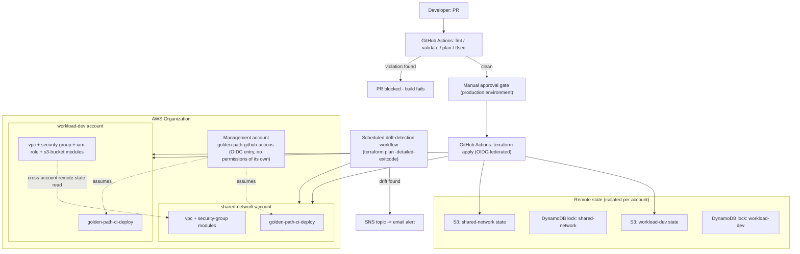

# golden-path-kit

[](https://github.com/BIGDADDY5802/golden-path-kit/actions/workflows/plan.yml)
[](https://github.com/BIGDADDY5802/golden-path-kit/actions/workflows/apply.yml)
[](https://github.com/BIGDADDY5802/golden-path-kit/actions/workflows/drift-detect.yml)
[](https://www.terraform.io/)
[](https://aws.amazon.com/)

A small, real, verified multi-account Terraform platform: reusable modules, isolated remote state, OIDC-federated CI/CD with a genuine approval gate, policy-as-code enforcement, and drift detection with alerting — all tested against live AWS, not just written and assumed to work.

Built as a portfolio project for an AWS + Terraform Engineer role. Every claim below was actually run and verified during development, including three separate "break it on purpose and confirm the safety net catches it" tests.

## What this demonstrates

- **Reusable Terraform modules** (`modules/`) with governance baked into the interface, not just caught by external scanning: a tagging-convention validation on every module, a `security-group` module that blocks `0.0.0.0/0` ingress unless explicitly overridden, and an `s3-bucket` module with no variable that can disable its public-access block.
- **Composition over duplication**: two environments (`environments/shared-network`, `environments/workload-dev`) compose the same four modules with environment-specific inputs — no resource logic duplicated between them.
- **A real multi-account AWS Organization setup**: isolated state per account, and a cross-account `terraform_remote_state` reference so `workload-dev` reads `shared-network`'s VPC CIDR directly out of its state file rather than hardcoding it.
- **OIDC-federated CI/CD** (GitHub Actions, no static AWS credentials) with a narrow per-account deploy role replacing the AWS Organization's admin-equivalent access role for all routine operations.
- **A real manual-approval gate**: verified live by merging a change, confirming via the GitHub API that the deployment genuinely sat in a `waiting` state (not just configured to look that way), approving it, and confirming the change landed in AWS.
- **Policy-as-code enforcement that actually blocks bad changes**: verified by opening a real PR with a deliberate public-ingress violation. First attempt revealed the scanner had been silently non-blocking the whole time due to a broken CI action — fixed that, then confirmed the pipeline genuinely fails the build on the real violation and passes clean once reverted.
- **Scheduled drift detection with SNS alerting**: verified by introducing real out-of-band drift (a tag added directly via the AWS API, bypassing Terraform entirely) and confirming the workflow detected it, published an alert, and failed the affected job — while the unaffected account's job stayed green.
- **Three architecture decision records** (`docs/adr/`) documenting the actual tradeoffs made, including one explicitly marked design-only where nothing was deployed.
- **A teardown script**, dry-run tested against the live environments before ever actually destroying anything.

## Architecture



## Repository structure

```text
bootstrap/          one-time setup (local state - can't bootstrap remote state remotely)
  accounts/            creates the AWS Organization member accounts
  state-backend/       creates the per-account S3 + DynamoDB remote-state backend
  oidc/                OIDC trust chain, per-account ci-deploy roles, SNS drift-alert topic

modules/            reusable building blocks, consumed by both environments
  vpc/
  security-group/
  iam-role/
  s3-bucket/

environments/       root compositions - one per AWS account
  shared-network/
  workload-dev/

.github/workflows/
  plan.yml             fmt / validate / tfsec / plan on every PR, posts the plan as a comment
  apply.yml            sequential per-account apply, gated by a required-reviewer environment
  drift-detect.yml     daily (+ on-demand) drift check with SNS alerting

docs/adr/           architecture decision records
scripts/teardown.sh  destroys environments/* only - never the bootstrap/ platform layer
```

## Design decisions

See [`docs/adr/`](docs/adr) for the full reasoning:

- [0001 — Module Versioning and Composition Strategy](docs/adr/0001-module-versioning.md)
- [0002 — Multi-Account Strategy](docs/adr/0002-multi-account-strategy.md)
- [0003 — Multi-Region Resilience](docs/adr/0003-multi-region-resilience.md) *(design-only, not deployed — see below)*

## Current status

The live `environments/*` infrastructure is **torn down** as of the last working session, to avoid ongoing AWS cost between demos — `scripts/teardown.sh` destroyed both environments, verified directly against the AWS API afterward (not just trusting Terraform's own output). The `bootstrap/` layer (the two AWS accounts, remote-state backends, OIDC trust chain, and SNS topic) is still up — it costs effectively nothing to leave running and would take real time to recreate.

To redeploy: with `bootstrap/` already in place, run `terraform init && terraform apply` in `environments/shared-network`, then the same in `environments/workload-dev` (that order matters — the latter reads the former's state).

**Known open item:** the SNS topic's email subscription has not successfully moved past `PendingConfirmation` despite clicking the confirmation link sent by AWS — root cause not yet diagnosed. The alert-publishing mechanism itself is verified working (confirmed via a real induced-drift test); only the email-delivery leg is unconfirmed.

## What was deliberately not built

Multi-region resilience was scoped as design-only from the start (see [ADR 0003](docs/adr/0003-multi-region-resilience.md)) given this project's time and cost constraints — not because it doesn't matter, but because an honest "here's what I'd build with more budget, and why I didn't" is worth more than an overclaimed live system.
